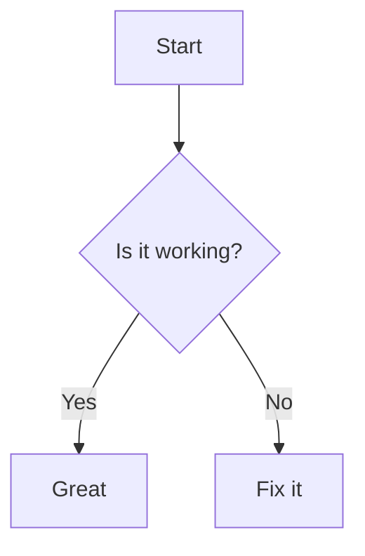
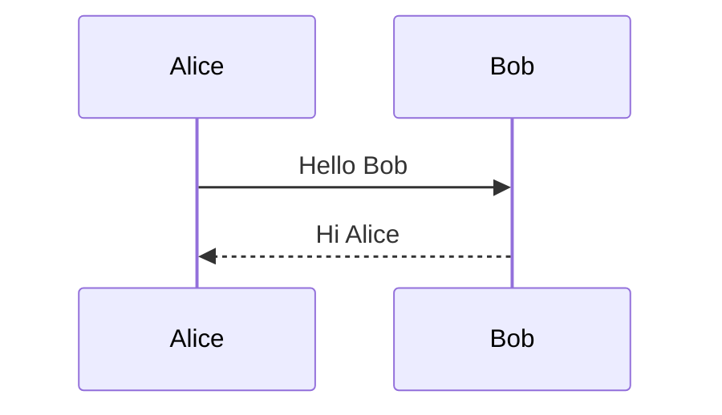

<link rel="stylesheet" href="style.css">

# Sample Document

Some **bold** text, a [link](https://example.com), and an [anchor](#second-section).

| A | B |
|---|---|
| 1 | 2 |

```ts
const x: number = 42;
```



Local image with space in path:


Data URI image:


Math: $E = mc^2$

<div class="bg-box">Background image box</div>

## Second Section

- [ ] task
- [x] done task



<div id="script-check">Scripts in the document don't run.</div>
<script>document.getElementById("script-check").textContent = "SCRIPT RAN";</script>

